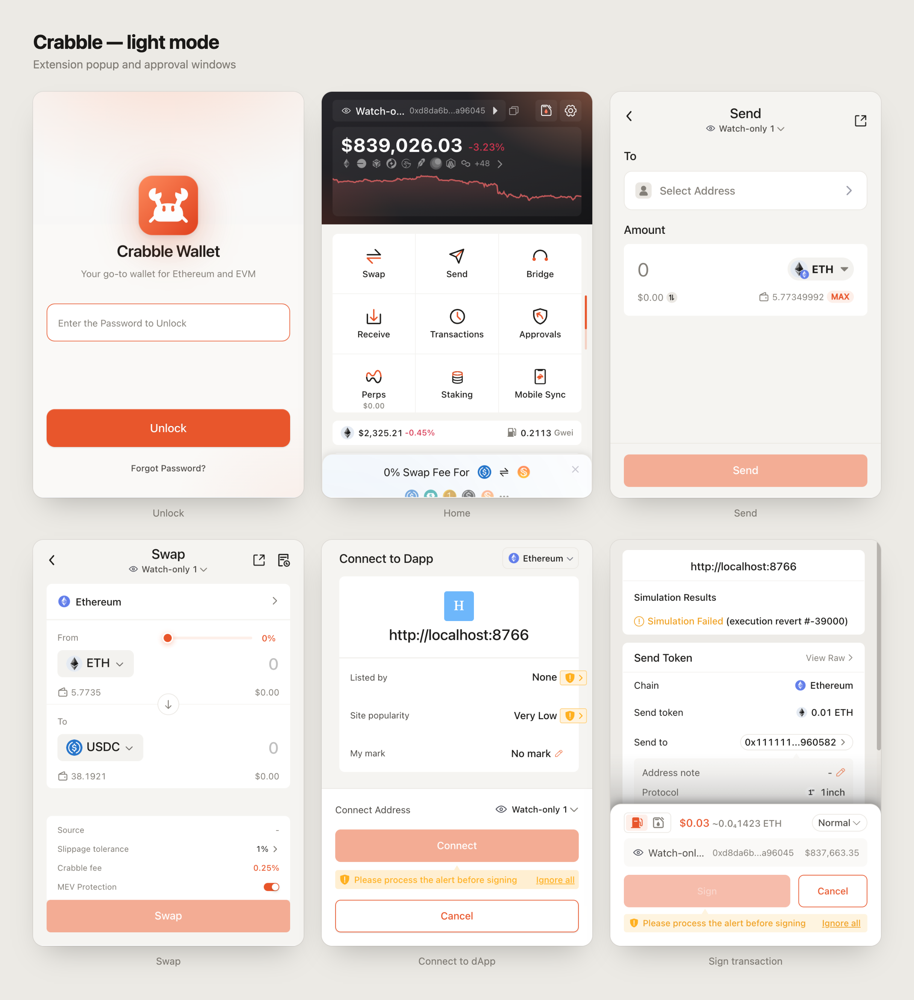

  

# Crabble

Crabble is a privacy-focused fork of [Rabby Wallet](https://github.com/RabbyHub/Rabby), the open-source browser extension wallet for Ethereum and EVM chains.

Forked from Rabby at commit `f3fa88953363307d51fec897caf26001781add20` (release 0.94.13) on Oct 26 00:05 PST.

## Install

Crabble is not published to an extension store. Build it from source (see [Development](#development)) and load the `dist` folder as an unpacked extension from `chrome://extensions`.

Crabble uses its own extension ID, so it can be installed alongside Rabby.

## dApp compatibility

Crabble announces itself over EIP-6963 as "Crabble" (`local.crabble`). For compatibility with dApps that look for Rabby, it still sets `window.ethereum.isRabby`.

## Contribution

### Install Dependency

1. Install Node.js version 22 or later.
2. Enable Corepack: `corepack enable`
3. Run `yarn install` to install dependencies.

### Development

Run `yarn build:dev` to develop with file watching and development logging (you can see requests sent by the dapp in the website console in this mode, and notifications will not close when focus is lost).

Run `yarn build:pro` to build a production package, which will be in the `dist` folder.

## Architecture

## Extension's Scripts

Below 4 scripts all live in different contexts!

### `background.js`

Handles all async requests and encryption tasks.

User's keyrings, passwords, and wallet personal preference data are all stored in Chrome local storage.

It has 2 main controllers:

1. `walletController`

   Exposes methods to the background window, so other scripts can access these methods with `runtime.getBackgroundPage`, e.g., `ui.js`.

2. `providerController`

   Handles requests from pages (dapp requests).

### `content-script`

Injected at `document_start`, shares the same DOM with the dapp, and uses `broadcastChannel` to tap `pageProvider`.

The main purpose is to inject `pageProvider.js` and pass messages between `pageProvider.js` and `background.js`.

### `pageProvider.js`

This script is injected into the dapp's context through `content-script`. It mounts `ethereum` to `window`.

When the dapp uses `window.ethereum` to request, it will send a message to `content-script` with `broadcastChannel` and wait for its response.

Then the `content-script` will send a message to `background` with `runtime.connect`.

After `background` receives the message, it will use `providerController` to handle the request and keep the message channel in `sessionService` for later communication.

### `ui`

Used by 3 pages which share the same JS code, but the HTML template is different for each respective purpose.

1. `notification.html`

   Triggered by the dapp to request the user's permission.

2. `index.html`

   Opened in a browser tab for a better user interaction experience.

3. `popup.html`

   Shown when the user clicks the extension icon to the right of the address bar.

## Thanks

Crabble is built on [Rabby Wallet](https://github.com/RabbyHub/Rabby) by DeBank. Rabby, in turn, uses (or forks) work from the MetaMask team; thanks to both for their contributions to the browser extension wallet community.

## Other Docs

- [How to add a new translation](/docs/translation.md)
- [Brand assets](/docs/brand/)
